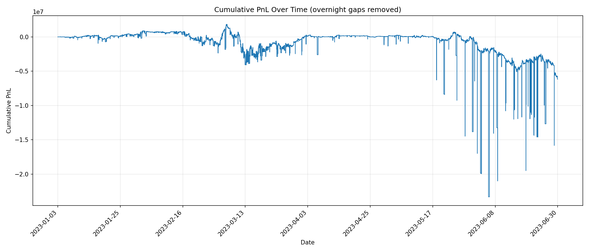
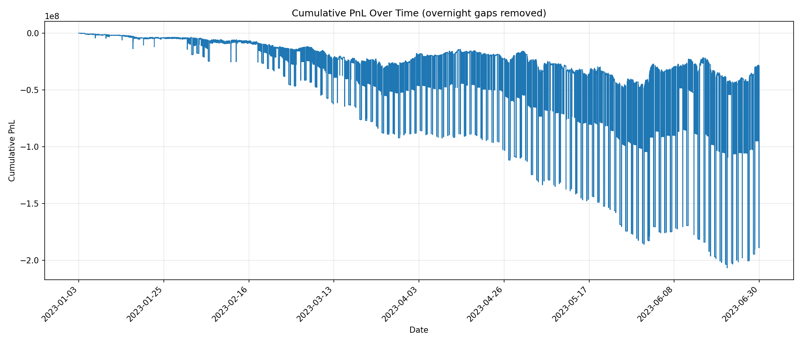

# FIN556 Group 3 Project Report

## Team Members

### Ellis Irwin (Team leader)

Email: ellisi2@illinois.edu

LinkedIn: linkedin.com/in/ellis-irwin/

I am a Master's student studying Computer Science at the University of Illinois Urbana-Champaing with a strong interest in
low-level systems programming and computer architecture. I have previously completed a software engineering internship at
Millennium Management where I learned to apply my computer science skills to financial markets.

### David Adam

Email: 

LinkedIn: 

(description)

### Dev Desai

Email: 

LinkedIn: 

(description)

## Preparation

### Initial strategy brainstorming

TODO: Talk about maybe some more complex strategies that we initially brainstormed

While we thought some of these more complex strategies would be cool, we moved away from them as none of us have super advanced
math knowledge or coursework. Additionally, having never worked with Strategy Studio before, these strategies may have been too
ambition as we also needed to spend time learning how to use Strategy Studio. For this reason we decided to stick to more basic 
index arbitrage and direct arbitrage strategies.

### Strategy Studio familiarization

In parallel with our initial strategy brainstorming and development, we spent a lot of the initial weeks of the project on
playing around within Strategy Studio to understand how to effectively use it and all of its capabilities. 

Starting by only having access to the command line was a challenge but gave us valueable experience working with systems that
only have command line access that we will likely see throughout our time in industry. This initial testing on the command line
gave us experience with the command line and allowed us to get a basic understanding of Strategy Studio.

### IEX Market Data Parser

In addition to theorizing mathematically about strategies and learning how to build them out in strategy studio, we also
had to work with the IEX market data pcaps and the given parser to successfully parse the data files that would be passed into
strategy studio.

We spent some time looking through the given parser and making some tweaks so that the parser correctly parsed the tickers
that we needed for our strategies.

## Strategies

### Index arbitrage

The first strategy that we implemented was an index arbitrage strategy for SPY (that we later repurposed to compare with DIA). 

Due to none of us having any significant strategy studio, we started with a very basic strategy that would be easiest to
implement and build on that to make it more complex. Each of the following optimizations were build out one at a time to
slowly progress and improve out strategy.

Our first step was to receive data for just SPY and MSFT and whenever there was a trade on MSFT, we would replicate the same
trade on SPY. At a basic level this is correct, if people are buying MSFT, and MSFT is a holding within SPY, then SPY should
go up, meaining we should purchase SPY. This is obviously a crude approximation though.

The next optimization we took was to use the last trade price as the price of the last stock and use the largest holdings
within SPY to calculate a theoretical price for SPY using weighted averages. For example, we started with the following: 
R_under = (7.38% * NVDA) + (6.25% * MSFT) + (3.87% * AMZN) + (2.55% * GOOG). We can then also calculate 
R_spy = (7.38% + 6.25% + 3.87% + 2.55%) * SPY. Theoretically, R_under = R_spy, if R_under is larger, we can submit a buy order
and if its smaller, we can submit a sell order to capitalize on discrepancies.

The next optimization was to use z-scores instead of the direct price difference of R_under and R_spy. We could calculate
delta = R_under - R_spy, if this delta was positive, that is a buy signal, and if negative, its a sell signal. We could then
maintain a rolling window of previous delta values and calculate the z-score of the newest delta in relation to previous ones.
If this delta is above our z-score threshold, then we would execute our buy or sell order.

We next realized that our pricing of instruments by just using last trade price was not very accurate, we should use some
price between the best bid and ask. For this, we decided to update our price for each stock on every OnTopQuote event, and
we calculated the weighted mid-price of the stock, this gave us a much more accurate price representation of each instrument

Next, we implemented dynamic position sizing. Currently, whenever our z-score is above the threshold we place an order of
the same size, this means that a z-score of 1.5 and 10 would both take the same position. We modified this to scale the
position size with the magnitude of the z-score, allowing us to caplitalize more on high z-scores and reduce risk on lower
z-scores.

#### SPY Index arbitrage

##### Results

##### Analysis

#### DIA Index arbitrage

##### Results

##### Analysis

Less liquid, we dont have the accurate basket weights (price weighted)

### Direct arbitrage

#### SPY/SPX arbitrage

#### DIA/DJIA arbitrage

## What we learned

## Future improvements

